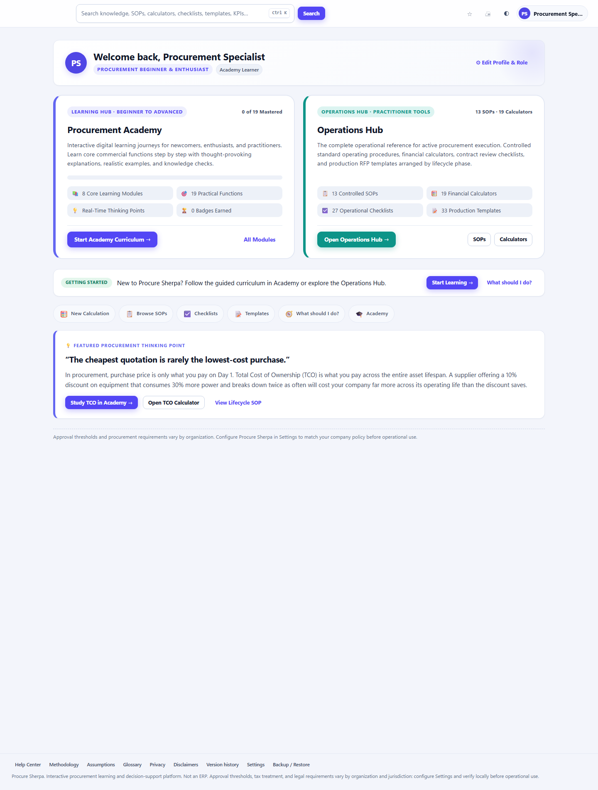
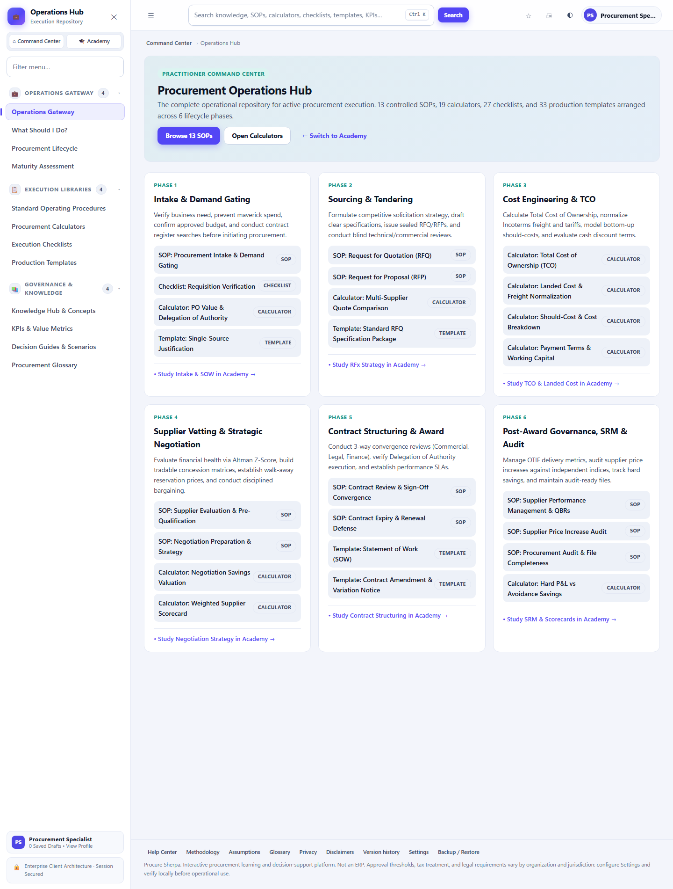
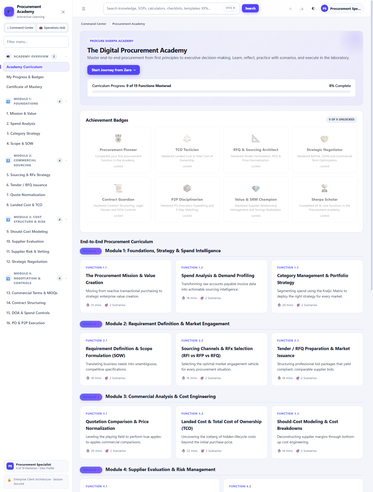
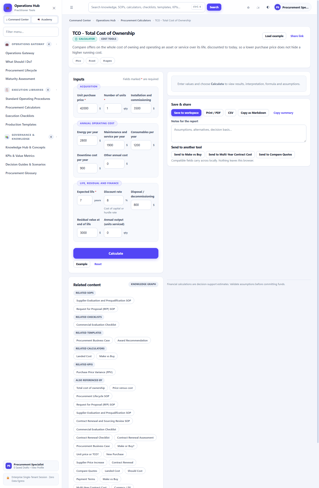
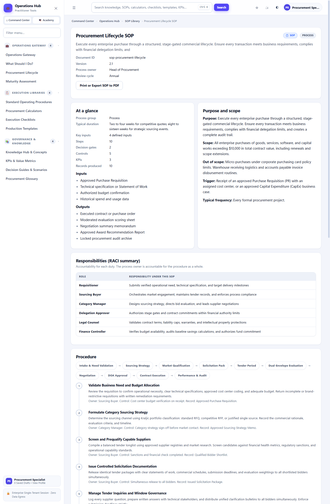
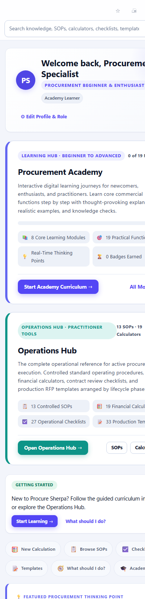
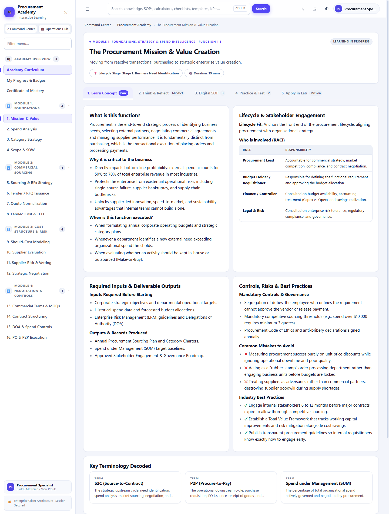

# Procure Sherpa v2.0

**An enterprise procurement learning and operations platform, compiled into a single offline HTML file.**

Competency curriculum, digital SOPs, compliance checklists, operational templates, financial calculators, decision frameworks, and inline visual analytics — no server, no database, no build step for end users, no telemetry.

[](LICENSE)
[](#repository-structure--source-code)
[](#data-privacy--security-architecture)
[](#operating-instructions)
[](.github/workflows/qa.yml)

> These badges describe static, verifiable facts about this repository (license file present, an empty `dependencies` block in `package.json`, no network calls at runtime). The QA badge reflects `.github/workflows/qa.yml`, which runs the full `npm run qa` gate **on every push and pull request to `main`**, plus a weekly scheduled run to catch environment drift. Earlier releases ran it weekly only and this note said so; that gap is now closed.

---

## Quick Start

**Just want to use it?** Download [`ProcureSherpa-v2.0.html`](ProcureSherpa-v2.0.html) and double-click it. That's the whole install — see [Operating Instructions](#operating-instructions) for a couple of other ways to open it.

**Want to change it?**
```bash
git clone https://github.com/chandrahotha/Procure_Sherpa.git
cd Procure_Sherpa
npm install        # dev-only: jsdom (tests), eslint (lint), terser (deploy build).
                   # `dependencies` is empty - nothing ships to a user.
                   # Also wires the pre-push safety hook.
npm run qa         # build + lint + the full test/audit suite - run this before every PR
```
Then see [Repository Structure & Source Code](#repository-structure--source-code) and [CONTRIBUTING.md](CONTRIBUTING.md).

---

## Table of Contents

- [Quick Start](#quick-start)
- [Screenshots](#screenshots)
- [Architecture Overview](#architecture-overview)
- [Core Capabilities](#core-capabilities)
- [Operating Instructions](#operating-instructions)
- [Repository Structure & Source Code](#repository-structure--source-code)
- [Build & Verification Commands](#build--verification-commands)
- [Governance & Standards Alignment](#governance--standards-alignment)
- [Data Privacy & Security Architecture](#data-privacy--security-architecture)
- [Known Limitations](#known-limitations)
- [Contributing & Security](#contributing--security)

---

## Screenshots

| Command Center | Operations Hub |
|---|---|
|  |  |

| Academy | Calculator |
|---|---|
|  |  |

| SOP detail | Mobile home |
|---|---|
|  |  |



---

## Architecture Overview

Procure Sherpa v2.0 separates strategic competency acquisition from day-to-day operational execution, while keeping navigation consistent everywhere through one unified sidebar.

```
                    ┌──────────────────────────────────────────────┐
                    │      Executive Command Center (#/home)       │
                    │  Personal start point · Today · Account Hub    │
                    │        (persistent sidebar, always open)      │
                    └──────────────────────┬───────────────────────┘
                                           │
             ┌─────────────────────────────┴─────────────────────────────┐
             ▼                                                           ▼
┌─────────────────────────────────────────┐ ┌─────────────────────────────────────────┐
│     Procurement Academy (#/academy)     │ │        Operations Hub (#/operations)    │
│  11 Modules · 28 Functions · 5-Tab      │ │  19 Financial Calculators · 13 SOPs     │
│  Pedagogy · Digital SOPs · Crisis       │ │  27 Compliance Checklists · 33 Templates│
│  Sandboxes · Progress Transcript        │ │  17 Decision Guides · 18 KPIs           │
│  (Certificates: future feature)         │ │  8 Workbenches for your own records     │
└─────────────────────────────────────────┘ └─────────────────────────────────────────┘
             │                                                           │
             └─────────────────────────────┬─────────────────────────────┘
                                            ▼
                    One persistent sidebar, on every route:
                    Start · Learn · Do the Work · Look It Up · My Work
                    (plus a permanent footer strip: Settings, Help, Backup, Changelog)
```

---

## Core Capabilities

| # | Capability | Summary |
|---|---|---|
| 1 | Command Center & Unified Navigation | One home, one sidebar scoped to the track you chose |
| 2 | Procurement Academy | 11 modules, 28 functions, 140 SOP steps, 112 questions, 5-tab pedagogy, certification exams |
| 3 | Visual Analytics Engine | Waterfall, Kraljic matrix, Pareto curve, Altman Z-Score, all inline SVG |
| 4 | Crisis Simulation Sandboxes | 10 hands-on commercial scenarios with live calculation models |
| 5 | Credential Transcript | Deliberately disabled — see below |
| 6 | Spotlight Command Palette | `Ctrl+K` search across the whole platform |
| 7 | Intelligence & Automation | Offline copilot, spend data model, doc pack builder |
| 8 | Analysis Workbench | What-if branching, static share pages |
| 9 | Workbenches | 8 local workbenches: RFx and evaluation, suppliers, contracts, catalogue, receipts, budget, approvals, analytics |

### 1. Command Center & Unified Navigation

* **Command Center (`#/home`)**: A personal start point that knows whether this is a first visit or a return, with the next useful action, a daily tip and the week's challenge above the two hub gateways, so a new user is told what to do and a returning user is told what is next.
* **One Sidebar, Scoped by Your Track**: The sidebar is present on every route including the Command Center, and it shows the navigation for the track you selected in your profile: **Learn** (5 sections, 26 items) for a learner, **Work** (6 sections, 30 items) for a practitioner, with the reference library - SOPs, checklists, templates, calculators, decision guides - shared between them, because the Academy is taught through it. A **Learn / Work** switch in the sidebar changes the track, and the page you are on is never a dead end: if it belongs to a section your track hides, that section appears. No hub-switching widget, and no second source of truth: the switch writes the same profile field the profile modal does.
* **Unified Account Profile & Session Management**: Manages user focus tracks, organizational roles, and mastery milestones, with a sidebar footer that shows Academy mastery progress or saved-draft count depending on where you are.

### 2. Procurement Academy & Competency Curriculum

* **11 Modules, 28 Functions**: Foundations/Strategy/Spend Intelligence, Requirement Definition & Market Engagement, Commercial Analysis & Cost Engineering, Supplier Evaluation & Risk Management, Negotiation Strategy & Commercial Terms, Contracting & Governance, Operational Purchasing & Order Execution (P2P), Supplier Management & Value Realization, Services/Software/Indirect Procurement, Risk/Compliance/Ethics/Sustainability, and Digital Procurement/Analytics/Category Strategy.
* **The curriculum is always in module order.** Module 1 to Module 11, for every role. The module number is the sequence, and a page whose first badge reads 'Module 7' tells the reader the page is broken. The role does not rearrange the curriculum; it recommends, in a panel directly under the hero, which modules carry that job's work - a compliance officer is pointed at Modules 4, 6, 8 and 10, a buyer at 2, 7 and 9 - and the curriculum below still runs 1 to 11.
* **Every function carries a worked example, in the explanation.** A case study is part of how a function works, not a separate reflection, so it sits in the Learn tab rather than the Think tab. The example links to the matching calculator with `?example=1`, so the reader arrives at a finished calculation rather than an empty form, and 27 of the 28 functions link to the workbench where that work is actually practised.
* **Disciplined 5-Tab Learning Pedagogy** per function:
  1. **Core Concept**: Theoretical foundation, commercial relevance, a worked example you can see happening, process walkthroughs, common failure modes, and governance rules.
  2. **Procurement Mindset**: Executive perspective, commercial thinking points, and the full enterprise case study with the reflection prompts.
  3. **Digital SOP**: Controlled procedural workflows detailing step roles, mandatory controls, records generated, and common pitfalls.
  4. **Interactive Practice**: Scenario-based knowledge evaluations featuring escalating difficulty tiers and automated tactical advisor tips triggered on mistakes.
  5. **Apply in Laboratory**: Interactive commercial crisis simulation sandboxes paired with hands-on laboratory missions.
* **Certification Exams (`#/exams`)**: Timed, randomised exams assembled from the Academy question bank (a full exam plus one per module), with a 70% pass mark, per-question timer, answer review, and local retake history.

### 3. Zero-Dependency Inline SVG Visual Analytics Engine

The platform incorporates a pure inline SVG data visualization engine that executes 100% offline with zero external charting dependencies:

* **Should-Cost Waterfall Buildup (`PS.chart.waterfall`)**: Unbundles cost components (Raw Materials, Direct Labor, Machine Overhead, SG&A Overhead, Fair Supplier Margin) against quoted vendor prices.
* **Kraljic 2x2 Portfolio Matrix (`PS.chart.kraljic`)**: Segments category expenditure by commercial profit impact and supply market risk into Strategic, Leverage, Bottleneck, and Non-Critical quadrants.
* **Pareto 80/20 Spend Distribution Curve (`PS.chart.pareto`)**: Combines ranked supplier spend columns with cumulative spend percentage spline curves and an 80% Class A cutoff threshold.
* **Altman Z-Score Solvency Dial (`PS.chart.zscoreGauge`)**: Calibrated semi-circular radial gauge indicating Distress (< 1.23), Grey Zone (1.23 to 2.90), and Safe Zone (> 2.90) supplier balance sheet liquidity health.

### 4. Interactive Commercial Crisis Simulation Sandboxes

Embedded within the Academy laboratory, each competency features live financial calculation models:

* **Spend Fragmentation & Tail Dissipation**: Pareto spend concentration analysis with Class A isolation and tail supplier consolidation rebate modeling.
* **Kraljic Portfolio Segmentation**: Category placement across supply risk and profit impact axes with strategic playbook alignment.
* **Bottom-Up Should-Cost Modeling**: Unbundles material and labor rates to expose supplier margin padding and construct formula-anchored counter-offers.
* **Critical Supplier Solvency Audit**: Altman Z-Score stress testing evaluating working capital, retained earnings, EBIT, equity, liabilities, and revenue.
* **Contract Clause Redline Auditing**: Interactive legal risk exposure metering across Limitation of Liability, Dispute Withholding, Warranty/SLA, and IP Rights.
* **Multi-Criteria Supplier Evaluation (MCDA)**: Weighted scoring comparison across Technical Quality, Landed Price, Delivery Resilience, ESG, and Solvency.
* **Global Incoterms TLC Normalization**: Equalizes overseas EXW terms against domestic DDP quotes including freight, duties, port drayage, and demurrage buffers.
* **Capex vs Opex Life-Cycle TCO**: Models 5-year operating equipment trade-offs, energy efficiencies, and capital payback horizons.
* **Three-Way Match Forensic Audit**: Resolves PO, GRN, and invoice variance discrepancies to enforce SOX 404 payment holds.
* **Monopoly Renewal Concessions**: Multi-variable commercial concession trading against sole-source vendors.
* **Emergency Price Increase Defense**: PPI commodity index and labor wage formula counter-offer calculations.

### 5. Credential Transcript (`#/certificate`) — disabled, future feature

Procure Sherpa is not a legally authorized issuer of procurement credentials, so certificate generation is turned off; `#/certificate` shows an honest "not available yet" notice instead of a certificate. Academy progress and exam scores are still tracked and visible on `#/academy-progress` and `#/exams`. The original tiered-transcript design is preserved in `IMPROVEMENT_ROADMAP.md` ("Certificates (deferred)") as a reference for a possible future release if a real verification/accreditation path exists.

### 6. Spotlight Command Palette (Ctrl+K / Cmd+K / `/`)

* Instant modal search accessible from any route.
* Multi-attribute weighted scoring across Academy competencies, SOPs, checklists, templates, calculators, and system actions.
* Keyboard navigation (`ArrowUp`, `ArrowDown`, `Enter`, `Escape`) with category filter chips.

### 7. Intelligence & Automation (`#/copilot`, `#/exams`, `#/spend-model`, `#/docpack`)

* **Offline Procurement Copilot (`#/copilot`)**: Local retrieval assistant that answers procurement questions from the bundled KB, glossary, SOPs, scenarios and calculators, with inline citations. Zero network, zero telemetry.
* **Spend Data Model (`#/spend-model`)**: Drag-drop category &gt; supplier hierarchy that feeds the Pareto and Kraljic charts from a single editable source, with impact/risk sliders.
* **Document Pack Builder (`#/docpack`)**: Assembles templates, checklists, decision guides and scenarios into a print-ready package with a cover sheet and table of contents, exportable to HTML or PDF.

### 8. Analysis Workbench Features

* **What-If Branching**: From any calculator, vary one input by a percentage and compare base vs scenario results side-by-side, saving branches as audit-ready workspace records.
* **Static Share Pages**: Export any route as a self-contained, read-only HTML snapshot for wikis, SharePoint, Confluence or email, with a single "Static share page" button.

---

### 9. Workbenches: your own records, held locally

The library teaches. The workbenches are where the work happens. All eight are local, all hold your own records, and all travel in the backup.

| Workbench | Holds | Computes |
|---|---|---|
| **RFx & Evaluation** (`#/rfx`) | Events, criteria, weights, bids | Landed cost per bid, weighted score, a written award recommendation, and the tension between the lowest landed cost and the highest score |
| **Supplier Register** (`#/suppliers`) | Contacts, qualification score, risk tier, approval state | Spend, risk distribution, high-risk count |
| **Contract Register** (`#/contracts`) | Value, key dates, notice deadline, obligations | Notice deadlines inside 180 days, auto-renewal exposure |
| **Catalogue & Price Book** (`#/catalogue`) | Items with specification, unit of measure, pack size, price | Price against a dated benchmark, items with no specification |
| **Receipts & Invoicing** (`#/receipts`) | Order, receipt and invoice as three numbers | Price variance, quantity variance at the invoiced price, uncontracted charges, duplicate invoices |
| **Budget & Spend** (`#/budget`) | Budget lines, committed, actual | Available, percentage used, against the spend model |
| **Approvals & Policy** (`#/approvals`) | Thresholds, chains, policy rules | The approval ladder, lowest limit first |
| **Analytics** (`#/analytics`) | Everything above | Spend by category, supplier risk, pipeline, match exposure, expiring contracts |

**What they do not do is the thing only a system of record can do.** The receipt workpaper finds the variance and does not release a payment. The approvals workbench records a delegation of authority and does not route an approval or block a purchase. The RFx workbench produces an award recommendation and does not constitute a tender.

**Every calculator can show itself working.** All 19 carry curated example data and a **Load example** button. **Random values** perturbs the example enough to change the answer and little enough that the figures still look like procurement, while respecting every rule the field declares - a random value that breaks the field's own rules teaches the reader that the tool is broken rather than that it is exploring.

## Browser Compatibility

Procure Sherpa targets **modern evergreen browsers** (Chrome, Edge, Firefox, Safari — latest 2 versions). The source is written in ES5 syntax for auditability, but the runtime uses ES2015+ built-ins (`Set`, `Map`, `Promise`, `Object.keys`, `Array.isArray`, `Number.EPSILON`). Internet Explorer is **not** supported.

---

## Operating Instructions

### Option 1: Direct File Launch (Simplest)
1. Locate `ProcureSherpa-v2.0.html` in the repository root.
2. Double-click the file to launch in any modern web browser (Chrome, Edge, Firefox, Safari).
3. The platform executes entirely within client memory with zero server dependencies.

### Option 2: Local HTTP Server (Recommended)
```bash
# Using Node.js
npx serve .

# Using Python
python -m http.server 8080
```
Open `http://localhost:8080/ProcureSherpa-v2.0.html` in your browser.

### Option 3: Use the hosted deployment

<https://procuresherpa.vercel.app> runs the current `main`. It behaves
identically to the downloaded file - still no server-side state, no accounts
and no telemetry - but it serves the **minified** build (~1.55 MB instead of
~1.98 MB, and ~546 KB over the wire once gzipped) and adds transport-level
hardening: HSTS, `X-Frame-Options: DENY`,
`X-Content-Type-Options: nosniff`, `Referrer-Policy: no-referrer` and a
restrictive `Permissions-Policy`.

Only the build output is served. `vercel.json` sets `outputDirectory` to
`dist`, so `src/`, `package.json` and everything else in the repository
return 404 - the deployment cannot serve source even by accident.

#### Releasing to Vercel

```bash
npm run deploy              # build, run the full gate, deploy to production
npm run deploy -- --dry     # do everything except the deploy
npm run verify:deploy       # assert the live site is the build you expect
```

`npm run deploy` runs the whole QA gate first, so a release can never
ship an artifact that has not passed the same checks CI runs. It then
deploys from a staging copy of the working tree that has no `.git`
directory, and `npm run verify:deploy` loads the **served** bytes and
asserts the same things the local gate asserts: the content registries
are populated, all 52 routes render real content with no sentinel
leaks, every internal link resolves, the navigation has the expected
shape and highlights correctly, and every cross-tool handoff still
carries data.

**Why the staging copy?** The Vercel project is connected to this
repository, and Vercel creates a deployment for every push to `main`.
On the Hobby plan every one of those deployments is blocked before a
build starts:

> The deployment was blocked because the commit author doesn't have
> permission to create deployments for this project.
> (`seatBlock: TEAM_ACCESS_REQUIRED`)

Hobby teams may not have members at all - the API answers *"Team
members are not permitted on the Hobby Plan"* - and the check Vercel
runs is whether the **commit author** maps to an account with team
access. A deployment pushed from a token is attributed to the token's
owner, who is the team owner, so it is not subject to that check. The
CLI picks the commit metadata up from the local Git repository, and
that metadata is what re-triggers the check, so the release script
deploys from a copy with no `.git` in it.

To make the native Git integration work instead, link the GitHub
account to the Vercel account (Vercel dashboard, **Account Settings ->
Connections -> GitHub**). That is a one-time change and needs no
workflow. The `Deploy` workflow in `.github/workflows/deploy.yml` is
the other route: it runs the same release script from CI with a
`VERCEL_TOKEN` repository secret, and is skipped rather than failed when
that secret is not set.

### Option 4: Host it yourself

`ProcureSherpa-v2.0.html` is a static file with no build step and no server
requirement, so any static host works - GitHub Pages (**Settings -> Pages ->
Branch: main**), S3, nginx, or a network share. Rename it to `index.html` if
the host expects one. For a smaller payload, run `npm run build:min` and
serve `dist/` instead.

### How the deployment is built

The hosted site is not the committed artifact copied into place. Vercel runs:

```bash
npm ci --include=dev                        # terser lives in devDependencies
node build.mjs && node tools/build_min.mjs  # readable artifact, then dist/
```

`--include=dev` is explicit because a build agent may set
`NODE_ENV=production`, under which a bare `npm ci` would omit the dev
dependencies the build needs. Minification is verified rather than trusted:
`npm run verify:min` re-runs the route smoke, both calculator suites and the
accessibility audit against `dist/index.html` before it is considered
shippable.

---

## Repository Structure & Source Code

`ProcureSherpa-v2.0.html` is a compiled release artifact generated from modular fragments in `src/`. Source modifications must be made within `src/` and recompiled — **never edit the root HTML file directly.**

```
ProcureSherpa-v2.0.html          # Compiled release artifact - readable, committed, downloadable
dist/                            # Minified deploy build (generated, gitignored, never committed)
build.mjs                        # Assembly + syntax + validation + performance budget gate
validate.mjs                     # Structural and syntax integrity validator
eslint.config.mjs                # Two lint configs: ES5 browser fragments, modern Node tooling
robots.txt                       # Crawl policy (see SEO note below)
LICENSE                          # ISC license
CONTRIBUTING.md                  # Dev setup, PR checklist, the rules that exist for a reason
SECURITY.md                      # Threat model, what's audited, how to report an issue
docs/adr/                        # Architecture decision records
  0001-single-file-architecture.md   # Why one file, and the triggers for revisiting it
.github/workflows/qa.yml         # CI: full gate on every push and PR, plus weekly
.githooks/pre-push               # Local safety net: drift check + fast tests before every push
src/
  manifest.txt                   # Linear assembly sequence (155 fragments)
  base/                          # Design tokens, CSS stylesheets, shell markup
  core/                          # Runtime engine, state stores, charts, router, search, i18n
  pages/                         # Page view renderers and interactive controllers
  content/                       # Controlled content libraries, SOPs, checklists, templates
  calcs/                         # Calculator definitions and implementation algorithms
tools/
  build_min.mjs                  # Minified deploy build -> dist/ (see ADR 0001)
  check_drift.mjs                # Asserts the committed artifact still matches src/
  smoke.mjs                      # Headless route test suite covering all 63 paths
  check_rels.mjs                 # Cross-reference referential integrity validator
  test_calcs.mjs                 # Calculator correctness harness (all 19 calculators)
  test_calc_values.mjs           # Expected-value fixtures: hand-computed math assertions
  test_interactive.mjs           # Click-through checks: search, palette, backup, prefs
  test_quiz_tips.mjs             # Content integrity gate + Academy quiz engine assertions
  security_audit.mjs             # CSP / eval / inline-handler / credential scan
  a11y_audit.mjs                 # WCAG 2.1 AA structural audit across 38 routes (visibility-aware)
  test_integrity.mjs             # Integrity gate: what the other tests cannot see (see below)
  perf_check.mjs                 # Single-file payload budget checker (hard + soft thresholds)
  i18n_audit.mjs                 # Catalog-keys-vs-DOM-usage coverage count (informational)
  setup_hooks.mjs                # Wires .githooks/ on `npm install` via the "prepare" script
  print_ids.mjs                  # Content registration ID inspector
  convert_v1.mjs, debug_calc.mjs, dump_index.mjs, inventory.mjs, probe_v1.mjs, lib.mjs
                                  # Internal dev/debug scratch scripts, not part of the QA gate
```

See [`src/README.md`](src/README.md) for the fragment-level architecture and execution-order rules.

## Build & Verification Commands

```powershell
# Compile single-file HTML bundle and validate syntax + performance budget
node build.mjs

# Full production QA gate (build + lint + all tests and audits, see below)
npm run qa

# What CI runs: the drift gate first, then the full suite
npm run qa:ci

# Lint. src/ is checked as ES5 browser script sharing one global scope;
# tools/ as modern Node ESM. Both configs live in eslint.config.mjs.
npm run lint

# Assert the committed artifact still matches src/ (no rebuild, no writes)
npm run check:drift

# Minified deploy build -> dist/, then the same tests against it
npm run verify:min

# Calculator correctness: asserts every calcImpl produces well-formed, finite output
node tools/test_calcs.mjs

# Run full route smoke tests across all 52 routes
node tools/smoke.mjs

# Validate the GitHub workflow files (a job-level `if` may not use `secrets`;
# a workflow that breaks this rule fails to compile and never runs a job)
npm run check:workflows

# Validate cross-reference referential integrity
node tools/check_rels.mjs

# Security audit: eval/new Function/inline handlers/javascript: URLs/CSP hygiene
node tools/security_audit.mjs

# Accessibility audit: labels, ARIA, heading hierarchy, duplicate IDs across 38 routes
npm run test:integrity    # The integrity gate: registries, sentinel leaks, dead links, orphan content, handoff viability, route reachability
npm run test:integrity      # The integrity gate: registries, sentinel leaks, dead links, orphan content, handoff viability
node tools/a11y_audit.mjs

# Responsive layout & dynamic UI structure verification
node tools/test_layout.mjs

# Performance budget check (HTML/JS/CSS payload ceilings)
node tools/perf_check.mjs
```

`npm run qa` runs, in order: build, lint, referential integrity, calculator correctness (1021 structural assertions), calculator expected-value fixtures (51 hand-computed math assertions), interactive click-through checks, the content and quiz-engine gate (18 assertions), route smoke (72 route renders across both navigation views), responsive layout & dynamic UI verification (29 assertions), the integrity gate (19 gates, 46 assertions), AST-based security scan (Espree traversal), accessibility scan (38 routes), the measured performance budget, the i18n coverage audit (100% shell catalog keys wired across English and Spanish), and finally the minified deploy build re-verified with the smoke, calculator, accessibility, and layout suites.

`npm run qa:ci` is what CI actually runs. It prefixes the suite with `npm run check:drift`, which must happen *before* anything rebuilds: `npm run qa` starts with `node build.mjs`, so running the drift check after it would regenerate the artifact and erase the very mismatch the check exists to find.

**A GitHub Actions workflow runs `qa:ci` on every push and pull request to `main`** (`.github/workflows/qa.yml`), plus weekly to catch environment drift. A **local pre-push git hook** runs the drift check and the fast test subset first, so the common mistakes fail in seconds on your machine rather than minutes later in Actions.

### Why the generated artifact is committed, and how it stays honest

`ProcureSherpa-v2.0.html` is both a build output *and* the product — "download one file and double-click it" only works if the file is in the tree. That creates exactly one failure mode: editing `src/` and committing without rebuilding, which would leave every test in this repo asserting against an artifact that is no longer the source of truth, and passing.

`tools/check_drift.mjs` closes it. It re-assembles the fragments in memory exactly as `build.mjs` does, byte-compares the result with the committed file, and on a mismatch names the first fragment that diverged. It writes nothing. It runs first in CI and in the pre-push hook.

### Expected-Value Calculator Fixtures

`tools/test_calc_values.mjs` goes beyond "does it run" and proves the calculators compute *correct* answers. Every one of the 19 calculators is run with its documented example (or a synthetic case) and the numeric output payload is asserted against a figure **computed independently by hand** in the test file — covering landed cost, TCO, negotiation savings, should-cost, price increase, price escalation, payment terms, PO value check, MOQ, make-vs-buy, supplier scorecard, concentration/HHI, budget-vs-actual, savings analysis, multi-year contract cost, GST, FX and KPI calculators. These fixtures catch silent formula regressions, inverted signs and broken rounding that finite-output tests cannot.

---

## Governance & Standards Alignment

Procure Sherpa v2.0 content and calculation models are aligned with international procurement standards:

* **Chartered Institute of Procurement & Supply (CIPS)**: Procurement lifecycle stages, sourcing ethics, and supplier relationship management.
* **Institute for Supply Management (ISM)**: Category management, cost modeling, and strategic sourcing methodologies.
* **Sarbanes-Oxley Act (SOX 404)**: Segregation of duties, 3-way matching controls, and formal delegation of authority (DOA) financial thresholds ($10,000, $100,000, $250,000).
* **International Commercial Terms (Incoterms 2020)**: Total landed cost risk and obligation allocation standards.
* **ISO 20400**: Sustainable procurement and ESG evaluation criteria.

CIPS/ISM/Incoterms/ISO references describe the frameworks the *content* is written against. Procure Sherpa itself is not accredited by, registered with, or endorsed by any of these bodies — see [Section 5](#5-credential-transcript-certificate--disabled-future-feature) on the disabled certificate feature.

---

## Data Privacy & Security Architecture

* **Single-Tenant Client Session**: All data, inputs, notes, and checklist progress reside strictly within the client browser's local storage.
* **Zero Network Egress**: The application issues zero outbound HTTP requests, trackers, cookies, or telemetry after initial load.
* **Audit-Compliant Archives**: Full platform state can be exported as structured, human-readable JSON archives via the Data Management center for local backup and migration across workstations.

---

## Known Limitations

Documented here deliberately, rather than left for someone to discover:

* **Multi-locale UI chrome is fully wired across English and Spanish (100% of shell catalog keys wired).** `PS.i18n` (`t()`, plural-safe substitution, locale persistence via preferences, and a working Settings language switcher) translates the persistent application shell, navigation sections, topbar search, modal dialogs, and calculator action bars across English (`en`) and Spanish (`es`) (`npm run audit:i18n` confirms 100% catalog key coverage). Detailed curriculum text, SOP long-form steps, and operational templates remain authored in English.
* **The i18n audit tracks catalog key and locale coverage.** It reports live statistics (`npm run audit:i18n`) to prevent catalog key drift. Every other check in `npm run qa` is a hard gate: lint, build drift, referential integrity, calculator correctness, content integrity, the quiz engine, route smoke, layout verification, AST security, accessibility and the performance budget all exit non-zero on failure.
* **Search engines see almost nothing.** The served markup is ~8 KB of shell; every page is rendered client-side behind a hash route (`#/academy`, `#/calc/...`), and fragments are never sent to the server, so there are no distinct indexable URLs. `sitemap.xml` therefore lists exactly one entry, and the canonical/Open Graph/JSON-LD tags describe the app as a whole rather than its pages. This is a straightforward consequence of the single-file architecture; making the content indexable would mean prerendering each route as a real URL, which is a different product. A `<noscript>` block gives crawlers and JS-disabled visitors a real description instead of a blank page, but it is a floor, not an SEO strategy.
* **No `og:image`.** Facebook, LinkedIn and Twitter require a real raster asset for a large link preview. Generating a 1200×630 PNG honestly would mean adding a rasterizer dependency for one image, which is not a trade this project wants to make. The exact tags to add, once such an asset exists, are written out in a comment in `src/base/01a_head.html`.
* **Certificates are intentionally disabled** (see [Section 5](#5-credential-transcript-certificate--disabled-future-feature)). This is a product decision, not a bug: the platform has no legal authority to issue procurement credentials, so it says so instead of pretending otherwise.
* **This is a single-user tool, not an enterprise system.** There is no server, no database, no account, no authentication and no multi-user state. Everything you enter lives in one browser's `localStorage` and disappears if that storage is cleared — use `#/backup` to export, which now carries the workbench records with it. The audit trail is a local convenience log, not a tamper-evident record, and nothing here is a system of record.
* **The workbenches are workpapers, not a system of record.** The eight workbenches hold your own suppliers, contracts, catalogue, budgets, bids, receipts and approvals, and they compute real answers from them: a landed cost, a weighted score, a three-way-match variance, a budget position, a pipeline. What they do not do is the things only a system of record can do. The receipt workpaper finds the variance and does not release a payment. The approvals workbench records a delegation of authority and does not route an approval, notify anyone, or block a purchase. The RFx workbench produces an award recommendation and does not constitute a tender. A sign-off is evidence that a named person took a decision, and it is worth exactly as much as that person is.
* **This is not an ERP.** Approval thresholds, tax treatment, and legal/compliance requirements vary by organization and jurisdiction. Configure `#/settings` and verify locally before relying on any output operationally.
* **The single-file design has a ceiling, and it is now measured rather than guessed.** The readable artifact is ~1.98 MB, of which ~546 KB reaches a browser once gzipped. All of it is parsed before first paint, and there is no code-splitting escape hatch — that constraint is the product, not an oversight. The deployment serves a minified variant (~1.62 MB, ~484 KB gzipped) that buys headroom without making the committed artifact unreviewable. [`docs/adr/0001-single-file-architecture.md`](docs/adr/0001-single-file-architecture.md) records the architecture decision, the trigger conditions for revisiting it, and what the alternatives would actually cost. [`docs/adr/0002-measured-performance-budget.md`](docs/adr/0002-measured-performance-budget.md) replaces the guessed byte ceilings with measured ones: script compile time (65 ms, full V8 parse), application boot to first rendered page (104 ms), and transferred size (546 KB gzipped, 1.46 s at 3 Mbps) are all hard gates in `npm run perf`. The timing budgets are measured twice before they fail, because a wall-clock measurement on a machine that is also running something else is a measurement of the machine as much as of the build; the size budgets are never retried, because they are facts about the file.
* **The QA badge reports the account's Actions state, not the code.** When GitHub cannot allocate a runner, the job is created with no steps and fails within seconds with *"recent account payments have failed or your spending limit needs to be increased"* (Settings -> Billing & plans). That is an account-level block and it looks identical to a broken build. The same gate runs locally with `npm run qa`, which is what `npm run deploy` uses before it will publish anything, so a release never depends on the hosted runner being available.
* **What the integrity gate catches that the other tests cannot.** `npm run test:integrity` runs 19 gates, 46 assertions. It renders all 52 routes in both navigation views and asserts that no page leaks `undefined`, `NaN` or `[object Object]`; that every internal link resolves; that every control has a handler; that every content item has an inbound link; that every cross-tool handoff can actually carry a value; that the Academy links into the library; that the assessment result reads back correctly; that the registries are populated; that the eight workbenches render and persist a record through the store; that the curriculum is in module order for every role and the role recommends rather than rearranges; that resume points at unfinished work; that every learning path is ascending; that every function shows a worked example and every calculator carries example data; that the menu is scoped to the track and the page you are on is in the menu; that no symbol has been mangled; and that no knowledge domain is split into a category of one. It exists because the suite was green while the Maturity page threw an uncaught `TypeError`, the Lifecycle page rendered zero stages, and a calculator silently inverted its RAG band.

---

## Contributing & Security

* **Contributing:** see [CONTRIBUTING.md](CONTRIBUTING.md) — dev setup, the PR checklist (`npm run qa`), the local pre-push hook, and the small set of rules (no invented accreditation claims, no new runtime dependencies, stay inside the performance budget) that exist for reasons documented elsewhere in this README.
* **Security:** see [SECURITY.md](SECURITY.md) — threat model for a client-only offline app, what `npm run qa`'s security audit actually checks, and how to report an issue.
* **Original product spec:** [`Procure_Sherpa_v2_Master_Requirements.md`](Procure_Sherpa_v2_Master_Requirements.md) is the founding requirements document this build was implemented against.
